# Manual de Uso do Painel Administrativo

## Blog Cigana Padilha ✨

Bem-vinda! Este manual foi feito com muito carinho para você aprender a cuidar do seu site sozinha, no seu tempo. Aqui você vai encontrar o passo a passo de tudo: como escrever uma postagem, como mudar o preço de uma consulta, como ver quem já pagou e muito mais.

Não precisa ter pressa nem medo de errar. Leia com calma, faça um passo de cada vez, e sempre que tiver dúvida volte para a seção que você precisa. As seções estão numeradas para facilitar.

> 💡 **O que é o "painel administrativo"?**
> É a parte secreta do seu site, onde só você entra com uma senha. É como a "cozinha" do site: os visitantes veem o resultado bonito na frente, e você prepara tudo por trás. Ninguém que visita o site consegue ver ou mexer nessa área.

> 📷 **Sobre as imagens deste manual:** todas as telas mostradas aqui são do painel de verdade, com exemplos inventados (postagens e clientes fictícios) só para ilustrar. No seu painel os nomes e números serão os seus.

---

## Índice das seções

1. [Como entrar no painel (login) e trocar a senha](#1-como-entrar-no-painel-login-e-trocar-a-senha)
2. [Como criar uma postagem nova](#2-como-criar-uma-postagem-nova)
3. [Como editar e organizar as postagens já criadas](#3-como-editar-e-organizar-as-postagens-já-criadas)
4. [Como trocar o valor de uma consulta (preço)](#4-como-trocar-o-valor-de-uma-consulta-preço)
5. [Categorias](#5-categorias)
6. [Tags (etiquetas)](#6-tags-etiquetas)
7. [Consultas recebidas (pagamentos)](#7-consultas-recebidas-pagamentos)
8. [Dicas de segurança e boas práticas](#8-dicas-de-segurança-e-boas-práticas)

---

## 1. Como entrar no painel (login) e trocar a senha

### 1.1. Entrar no painel

1. Abra o navegador de internet (Google Chrome, Safari, Firefox — qualquer um serve).
2. Na barra de endereço lá em cima (onde você digita os sites), digite o endereço do seu site seguido de **`/admin/`**. Por exemplo:
   `www.seusite.com.br/admin/`
   *(Guarde esse endereço nos favoritos do navegador para não precisar digitar toda vez.)*
3. Vai aparecer uma telinha com o título **"✨ Blog Cigana Padilha - Admin"** pedindo **Usuário** e **Senha**.
4. Digite o seu **usuário** e a sua **senha** (aqueles que foram criados para você).
5. Clique no botão azul **"Acessar"**.

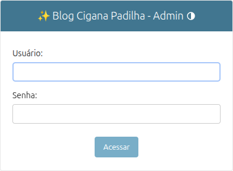

> ⚠️ **Cuidado ao errar a senha:** por segurança, se você errar a senha **5 vezes seguidas**, o sistema bloqueia o acesso por **1 hora** para proteger o site de invasores. Se isso acontecer, é só esperar 1 hora e tentar de novo com calma — ou pedir ajuda a quem cuida da parte técnica do site. Por isso, digite com atenção.

Pronto! Você está dentro do painel. Aparece a tela principal, com o título **"Gerenciar Conteúdo"**, e as coisas que você pode gerenciar ficam separadas em blocos:

- **CORE** — é o bloco do blog: **Categorias**, **Posts** e **Tags**;
- **CONSULTAS** — é o bloco das consultas: **Consultas** (os pagamentos recebidos) e **Tipos de Consulta** (os serviços e seus preços);
- **AUTENTICAÇÃO E AUTORIZAÇÃO** e **AXES** — são blocos **técnicos**, de uso de quem cuida do sistema. **Você não precisa mexer neles.** Pode passar direto.

Em cada linha há dois links: **"Adicionar"** (para criar uma coisa nova) e **"Modificar"** (para ver a lista do que já existe e editar).

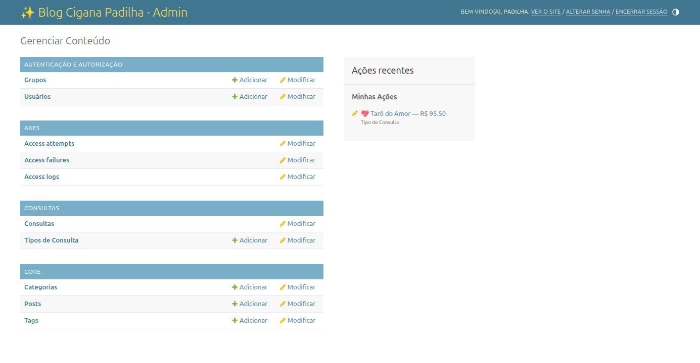

> 💡 **A barra lateral esquerda:** dentro de qualquer tela do painel existe um menu do lado esquerdo com os mesmos itens (Posts, Categorias, Tags, Consultas, Tipos de Consulta). É um atalho: você pode pular de uma parte para outra sem voltar ao início. Se ele estiver atrapalhando, clique na setinha **«** para escondê-lo (e em **»** para trazê-lo de volta).

### 1.2. Sair do painel (logout)

Quando terminar de usar, é importante sair, principalmente se o computador for compartilhado.

1. No canto superior direito da tela, você vê **"BEM-VINDO(A), [SEU USUÁRIO]"** e três links.
2. Clique em **"ENCERRAR SESSÃO"**.

> 💡 O link **"VER O SITE"**, nesse mesmo canto, abre o seu site como os visitantes o veem. É ótimo para conferir se a postagem ficou bonita depois de publicar.

### 1.3. Trocar a sua senha

É recomendável trocar a senha de vez em quando, e sempre que achar que alguém pode ter descoberto.

1. Já dentro do painel, olhe no canto superior direito da tela.
2. Clique em **"ALTERAR SENHA"**.
3. Vai abrir uma tela pedindo três coisas:
   - **Senha antiga:** digite a senha que você usa hoje.
   - **Nova senha:** digite a senha nova que você quer usar.
   - **Confirmação da nova senha:** digite a senha nova de novo, igualzinha, para confirmar.
4. Clique no botão **"ALTERAR MINHA SENHA"**.

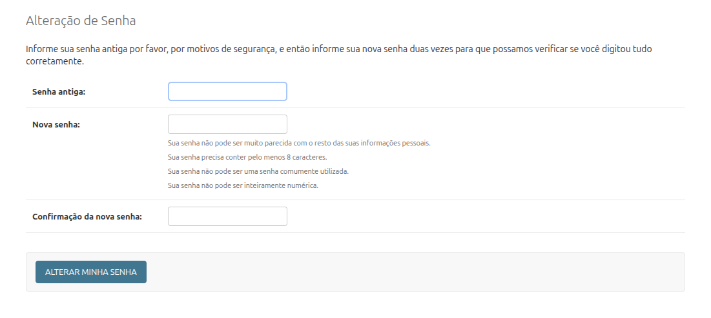

A própria tela mostra as regras da senha nova, e o sistema não aceita uma senha que desobedeça alguma delas:

- precisa ter **pelo menos 8 caracteres**;
- não pode ser **só números**;
- não pode ser uma senha **muito comum** (como "123456" ou "senha");
- não pode ser **parecida demais com os seus dados** (seu nome de usuário, seu e-mail).

> 💡 **Dica para criar uma boa senha:** junte duas palavras que só você conhece com um número no meio, por exemplo: `Lua27Estrela`. Evite datas de aniversário e nomes óbvios. Anote em um lugar seguro (um caderninho guardado, não num papel colado no monitor).

---

## 2. Como criar uma postagem nova

Uma "postagem" (ou "post") é um texto que aparece no seu blog — pode ser uma mensagem do dia, um artigo sobre tarô, uma reflexão, um vídeo, etc.

### 2.1. Começando

1. Na tela principal do painel, procure o bloco **CORE** e, dentro dele, a linha **"Posts"**.
2. Clique no link verde **"✚ Adicionar"** que fica na mesma linha. *(Outro caminho: clicar em "Posts" e, na tela da lista, no botão "ADICIONAR POST ✚" do canto superior direito.)*

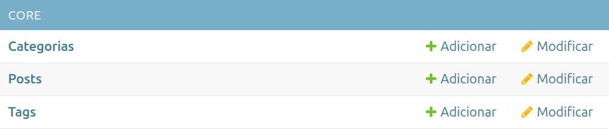

Vai abrir um formulário grande, dividido em partes (blocos). Vamos preencher cada campo com calma. Não se assuste com o tamanho: nem todo campo é obrigatório.

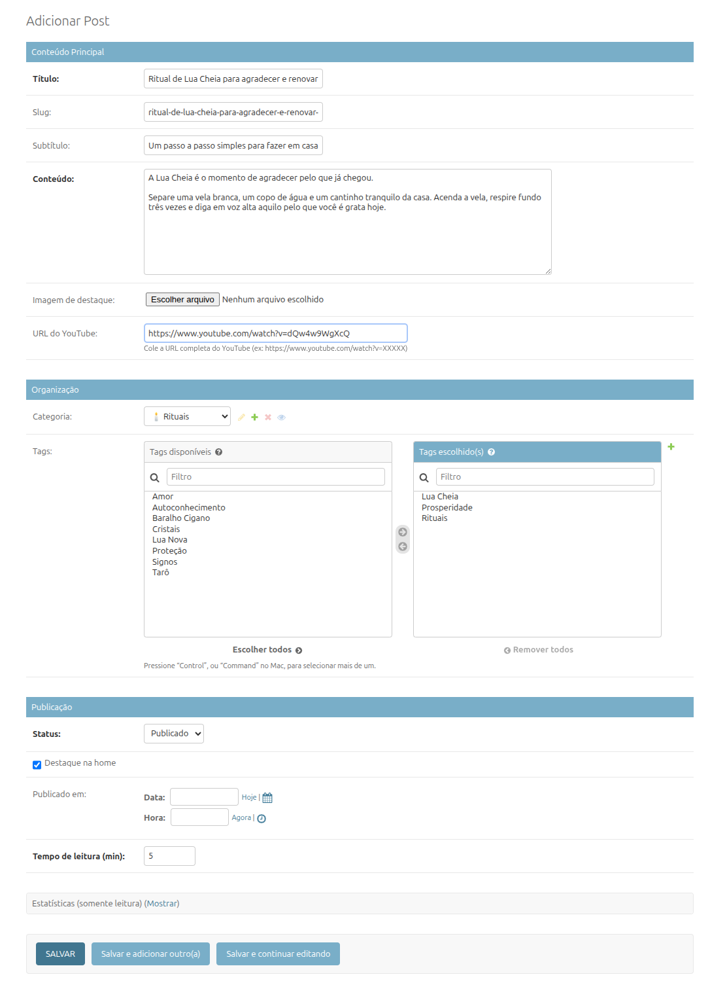

### 2.2. Bloco "Conteúdo Principal"

- **Título** *(obrigatório)*
  É o nome da sua postagem, o que aparece grande em cima. Escreva algo chamativo e claro.
  *Exemplo:* `A mensagem das cartas para esta semana`

- **Slug**
  É o "endereço" da postagem na internet (a parte final do link). **Você não precisa se preocupar com ele:** o sistema preenche sozinho, automaticamente, conforme você digita o Título. Pode deixar como está.

- **Subtítulo** *(opcional)*
  Uma frase curta que complementa o título, tipo uma chamada. Pode deixar em branco se não quiser.
  *Exemplo:* `O que o baralho cigano revela sobre amor e trabalho`

- **Conteúdo** *(obrigatório)*
  Aqui vai o texto principal da sua postagem — a matéria inteira. Escreva à vontade, quantos parágrafos quiser. É o corpo do texto que as pessoas vão ler.

- **Imagem de destaque** *(opcional, mas recomendada)*
  É a foto/ilustração grande que aparece no topo da postagem. Clique em **"Escolher arquivo"**, procure a imagem no seu computador ou celular e selecione. Enquanto você não escolher nada, aparece escrito "Nenhum arquivo escolhido". Prefira imagens em boa qualidade e na horizontal.

  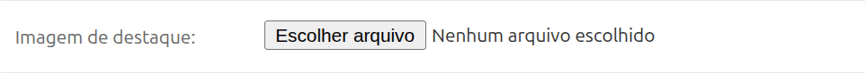

- **URL do YouTube** *(opcional)*
  Se você quiser colocar um vídeo do YouTube na postagem, copie o endereço completo do vídeo (aquele que começa com `https://www.youtube.com/...`) e cole aqui. O vídeo vai aparecer bonito dentro da postagem, pronto para tocar. Se não for usar vídeo, deixe em branco.
  *Exemplo:* `https://www.youtube.com/watch?v=XXXXX`

  > 💡 O sistema entende vários formatos de link do YouTube (o link normal, o encurtado `youtu.be`, os Shorts, os links de transmissão ao vivo). É só colar o link que ele se vira.

### 2.3. Bloco "Organização"

- **Categoria** *(opcional)*
  É o assunto/tema da postagem (por exemplo: "Tarô", "Rituais", "Cristais"). Clique na caixinha e escolha uma das categorias já existentes. Isso ajuda a organizar o site e facilita para os visitantes encontrarem assuntos parecidos.
  *(Se a categoria que você quer ainda não existe, veja a [Seção 5](#5-categorias) para criar antes.)*

- **Tags** *(opcional)*
  São "etiquetas", palavras-chave menores que descrevem a postagem (por exemplo: "Lua Cheia", "Amor", "Prosperidade"). Aparecem **duas caixas lado a lado**: na da esquerda, "Tags disponíveis"; na da direita, "Tags escolhido(s)".
  Para escolher uma tag: **clique duas vezes** no nome dela na caixa da esquerda — ela pula para a direita. *(Também dá para clicar uma vez e usar a setinha ➜ que fica entre as duas caixas.)* Para tirar uma tag escolhida, faça o contrário: clique duas vezes nela na caixa da direita.
  Se tiver muitas tags, use a caixa **"Filtro"** acima da lista para achar pelo nome. Você pode escolher quantas quiser.
  *(Para criar tags novas, veja a [Seção 6](#6-tags-etiquetas).)*

  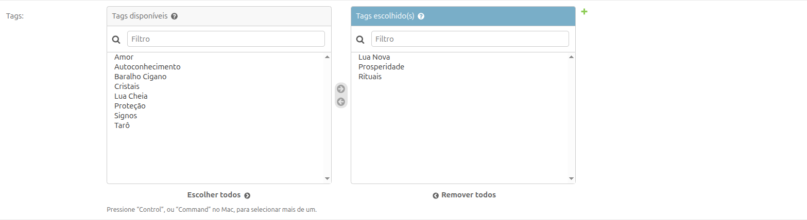

### 2.4. Bloco "Publicação"

- **Status** *(importante!)*
  Aqui você decide se a postagem já vai para o ar ou não. São duas opções:
  - **Rascunho:** a postagem fica guardada só para você, **ninguém que visita o site consegue vê-la**. Use enquanto ainda está escrevendo ou pensando.
  - **Publicado:** a postagem **fica visível para todo mundo** no site.

  > 💡 **Dica:** enquanto estiver escrevendo, deixe em **Rascunho**. Quando estiver tudo pronto e revisado, mude para **Publicado**.

- **Destaque na home** *(opcional)*
  É uma caixinha de marcar (✓). Se você marcar, essa postagem ganha um lugar de destaque na página inicial (a "home") do site. Use para aquela postagem especial que você quer que todos vejam primeiro. Se não marcar, a postagem aparece normalmente na lista, sem destaque especial.

- **Publicado em** *(opcional)*
  É a data e a hora em que a postagem foi publicada — são dois campinhos, **Data** e **Hora**, com os atalhos "Hoje" e "Agora" do lado. **Você não precisa mexer:** se deixar em branco e o Status estiver como "Publicado", o sistema preenche sozinho com o momento em que você salvar. Só mexa se quiser registrar uma data específica.

  > ⚠️ **Atenção:** se você mudar uma postagem publicada de volta para **Rascunho**, essa data é **apagada**. Quando publicar de novo, ela recebe a data nova (do dia em que você republicou). Isso não estraga nada, mas é bom saber para não estranhar.

- **Tempo de leitura (min)** *(opcional)*
  É um número que mostra ao visitante quantos minutos ele leva para ler a postagem (por exemplo, "5 min de leitura"). O sistema já vem com o número **5** preenchido. Se sua postagem for bem curtinha, pode colocar 2 ou 3; se for longa, pode colocar 8, 10, etc. Não precisa ser exato.

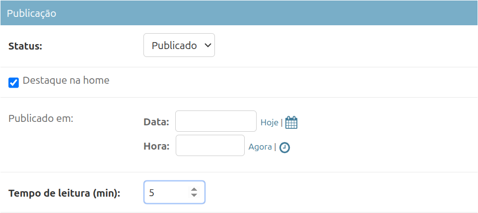

### 2.5. Salvar a postagem

Quando terminar, role a tela até o final. Você verá os botões de salvar:

- **"SALVAR"** — salva e volta para a lista de postagens.
- **"Salvar e adicionar outro(a)"** — salva e já abre um formulário em branco para criar mais uma.
- **"Salvar e continuar editando"** — salva mas continua na mesma tela, útil para conferir ou continuar mexendo.

Para o dia a dia, o botão **"SALVAR"** é o que você mais vai usar.

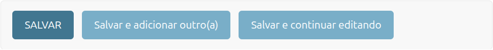

Deu certo? O painel avisa com uma **faixa verde** no topo da tela seguinte, dizendo que o item foi adicionado ou alterado com sucesso. Essa faixa verde é a confirmação de que está tudo salvo.

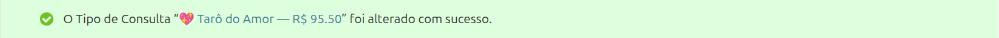

> 📌 **Sobre o bloco "Estatísticas (somente leitura)":** lá no final do formulário há um bloco recolhido chamado "Estatísticas". Se você clicar em **"Mostrar"**, ele abre e mostra o número de **Visualizações** (quantas pessoas viram a postagem), a data de criação e a data da última atualização. Esses campos são **só para você conferir** — não dá para editar, e nem precisa. Pode ignorar tranquilamente.

---

## 3. Como editar e organizar as postagens já criadas

### 3.1. Ver a lista de postagens

1. Na tela principal do painel, clique em **"Posts"**.
2. Vai aparecer a lista de todas as suas postagens, da mais recente para a mais antiga. Para cada uma, você vê em colunas:
   - **Título** — o nome da postagem;
   - **Categoria** — o tema;
   - **Status** — se está "Rascunho" ou "Publicado";
   - **Destaque na home** — se está marcada como destaque (✓) ou não;
   - **Publicado em** — a data e a hora (um tracinho "-" quer dizer que ainda não foi publicada);
   - **Visualizações** — quantas pessoas viram.

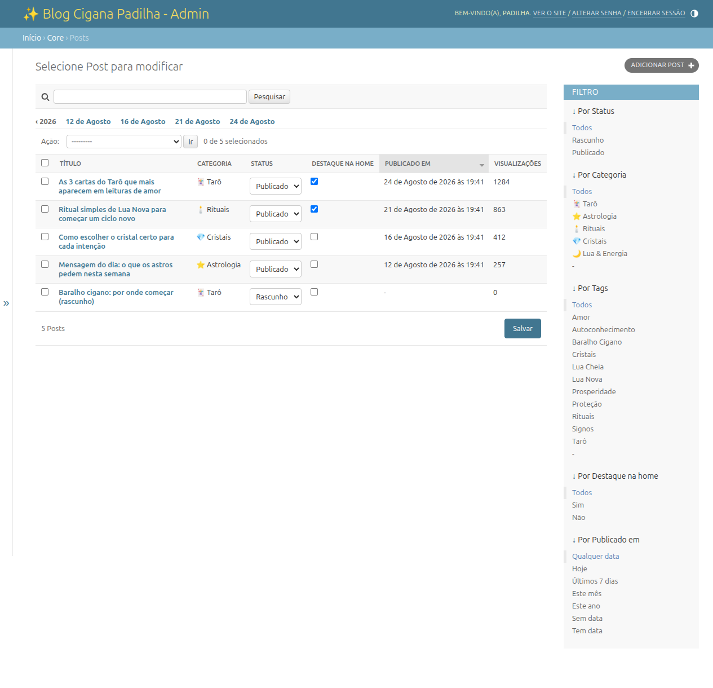

### 3.2. Buscar uma postagem

Se você tem muitas postagens, use a caixa de **busca** no topo da lista. Digite uma palavra do título, do subtítulo ou do conteúdo e clique em **"Pesquisar"**. O sistema mostra só as postagens que combinam e escreve ao lado quantas encontrou (por exemplo, "1 resultado (5 total)").

Para voltar a ver todas, apague o que você digitou e clique em "Pesquisar" de novo.

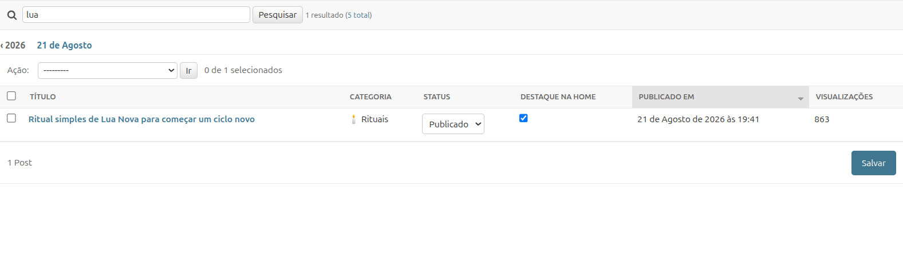

### 3.3. Filtrar as postagens

Do lado direito da lista há um painel **FILTRO** que ajuda a encontrar postagens rapidamente. Você pode filtrar por:
- **Por Status** (só rascunhos ou só publicados);
- **Por Categoria**;
- **Por Tags**;
- **Por Destaque na home** (Sim ou Não);
- **Por Publicado em** (Hoje, Últimos 7 dias, Este mês, Este ano...).

É só clicar na opção desejada; para desfazer, clique em **"Todos"** daquele filtro. Há também, logo acima da lista, uma navegação por **datas** (ano e dias) para achar postagens de um período.

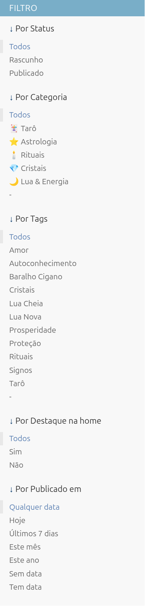

### 3.4. Editar uma postagem

1. Na lista, clique no **título** da postagem que você quer mudar.
2. Abre o mesmo formulário da criação (Seção 2), já preenchido.
3. Altere o que precisar.
4. Clique em **"SALVAR"** no final.

### 3.5. Mudar rápido de Rascunho para Publicado (sem abrir a postagem)

Na própria lista, as colunas **Status** e **Destaque na home** podem ser editadas direto:
- Na coluna **Status**, clique na caixinha e escolha "Rascunho" ou "Publicado".
- Na coluna **Destaque na home**, marque ou desmarque o ✓.

Depois de mexer, **role até o fim da lista e clique no botão "Salvar"** para confirmar as mudanças de todas as linhas de uma vez. Se você sair da tela sem clicar em "Salvar", as mudanças se perdem.

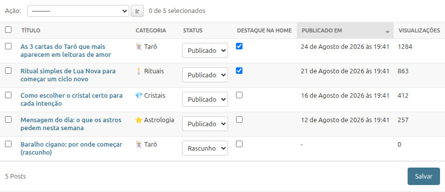

> 💡 **Diferença entre Rascunho e Publicado (relembrando):** Rascunho = só você vê. Publicado = todo mundo vê no site. Para "tirar do ar" uma postagem temporariamente sem apagá-la, basta mudar de "Publicado" para "Rascunho".

### 3.6. Excluir (apagar) uma postagem

> ⚠️ **Atenção:** apagar é para sempre. A postagem some e não dá para recuperar. Só apague se tiver certeza. Muitas vezes, o melhor é apenas mudar para **Rascunho** em vez de apagar.

Para apagar:
1. Abra a postagem (clique no título).
2. Role até o final e clique no botão vermelho **"Apagar"**, do lado direito.

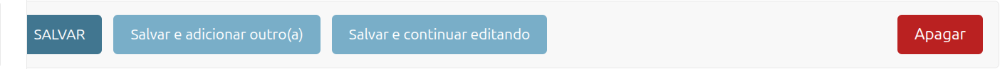

3. O sistema abre uma tela de confirmação chamada **"Tem certeza?"**, mostrando o que será removido junto (as ligações da postagem com as tags, por exemplo — isso é normal, não apaga as tags em si).
4. Se tiver certeza, clique no botão vermelho **"Sim, eu tenho certeza"**. Se mudou de ideia, clique em **"Não, me leve de volta"**.

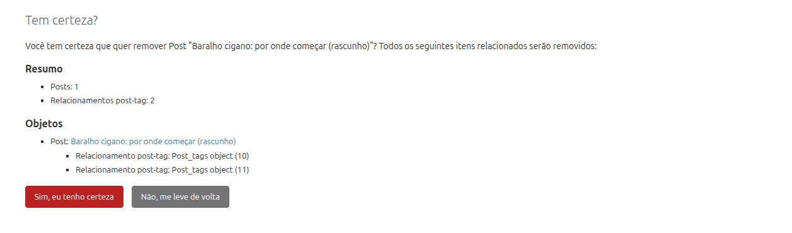

Também é possível apagar várias de uma vez: na lista, marque a caixinha ✓ à esquerda das postagens que quer apagar, escolha a ação **"Remover Posts selecionados"** na caixa **"Ação:"** do topo e clique em **"Ir"**. O sistema vai pedir a mesma confirmação.

---

## 4. Como trocar o valor de uma consulta (preço)

Os preços das consultas ficam em **"Tipos de Consulta"**, dentro do bloco **CONSULTAS**. Cada "tipo de consulta" é um serviço que você oferece (por exemplo: "Tarô do Amor", "Mapa Astral Completo", "Consulta Geral com Baralho Cigano"), cada um com seu próprio preço.

### 4.1. Abrir os tipos de consulta

1. Na tela principal do painel, clique em **"Tipos de Consulta"**.
2. Vai aparecer a lista com todos os serviços que você oferece. Em colunas você vê:
   - **Ícone (emoji)** — o desenhinho (🔮, 💖, ⭐, etc.);
   - **Nome** — o nome do serviço;
   - **Preço (R$)** — o valor em reais;
   - **Duração (min)** — quantos minutos dura;
   - **Ativo** — se está sendo oferecido (✓) ou não;
   - **Ordem** — a posição em que aparece na lista do site.

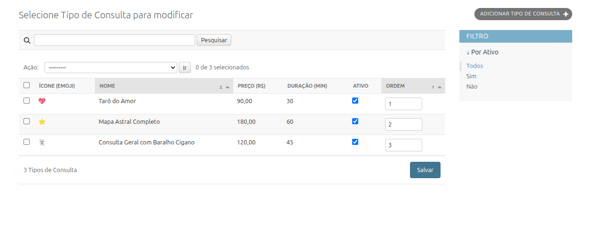

### 4.2. Mudar o preço (e outros dados)

1. Na lista, clique no **nome** do serviço que você quer mudar.
2. Abre o formulário com os campos:
   - **Nome:** o nome do serviço. Pode mudar se quiser (ex.: de "Tarô" para "Tarô do Amor").
   - **Slug:** o endereço na internet — preenche sozinho a partir do nome. Pode deixar como está.
   - **Descrição:** um texto explicando o que é a consulta (aparece no site para o cliente entender). Opcional.
   - **Preço (R$):** **este é o campo do valor.** Apague o valor que está lá e digite o novo. Use **ponto** para separar os centavos: para cem reais digite `100.00`; para oitenta reais e cinquenta centavos, `80.50`. *(Depois de salvar, a tela mostra o valor com vírgula — `80,50` — porque é assim que se escreve dinheiro em português. Está certo.)* Você também pode usar as setinhas ▲▼ do lado do campo para subir ou descer de centavo em centavo.
   - **Duração (min):** quantos minutos dura a consulta. Vem preenchido com 30. Pode mudar.
   - **Ícone (emoji):** o emoji que aparece ao lado do nome. Pode trocar por outro que combine.
   - **Ativo:** caixinha de marcar. Se **marcada (✓)**, o serviço aparece no site e as pessoas podem contratar. Se **desmarcada**, o serviço **some do site** (fica pausado) — útil quando você quer parar de oferecer aquele serviço por um tempo, sem apagá-lo.
   - **Ordem:** um número que define a posição do serviço na lista do site. Menor número aparece primeiro (1 vem antes de 2, que vem antes de 3, e assim por diante).
3. Depois de digitar o novo preço, clique em **"SALVAR"**. A faixa verde no topo confirma a alteração e já mostra o valor novo.

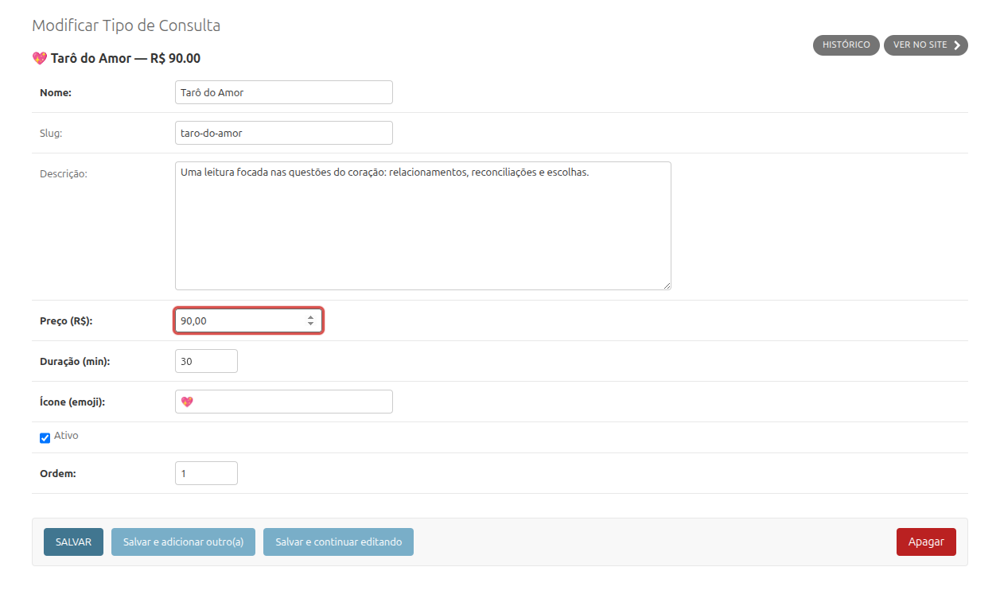

> ⭐ **MUITO IMPORTANTE — leia com atenção:**
> Quando você muda o preço, **o novo valor vale apenas para as consultas NOVAS**, ou seja, para as pessoas que agendarem a partir de agora. As consultas que já foram feitas e pagas antes **continuam com o valor antigo** (o que a pessoa realmente pagou). Isso é o correto: o sistema guarda o valor que valia no momento de cada agendamento, para não bagunçar o histórico nem cobrar diferente de quem já pagou. Então pode mudar o preço tranquila — nada muda para quem já pagou.

### 4.3. Atalho: mudar Ativo e Ordem direto na lista

Na lista de "Tipos de Consulta", as colunas **Ativo** e **Ordem** podem ser editadas direto (sem abrir o serviço). Faça as mudanças e clique em **"Salvar"** no final da lista. *(O preço, porém, só se altera abrindo o serviço, como no passo 4.2.)*

### 4.4. Criar um serviço novo

Se quiser oferecer um novo tipo de consulta:
1. Em "Tipos de Consulta", clique em **"ADICIONAR TIPO DE CONSULTA ✚"** (canto superior direito).
2. Preencha os campos (principalmente Nome e Preço — os dois são obrigatórios).
3. Deixe **Ativo** marcado para ele aparecer no site.
4. Clique em **"SALVAR"**.

---

## 5. Categorias

As **Categorias** são os grandes temas que organizam suas postagens (ex.: "Tarô", "Astrologia", "Rituais", "Cristais"). Elas ajudam os visitantes a navegar por assunto.

### 5.1. Ver e criar categorias

1. Na tela principal, clique em **"Categorias"**.
2. Você vê a lista com: **Ícone (emoji)**, **Nome**, **Slug**, **Ordem** e **Ativo**.
3. Para criar uma nova, clique em **"ADICIONAR CATEGORIA ✚"** (canto superior direito) ou no link **"✚ Adicionar"** da linha "Categorias", lá na tela principal.

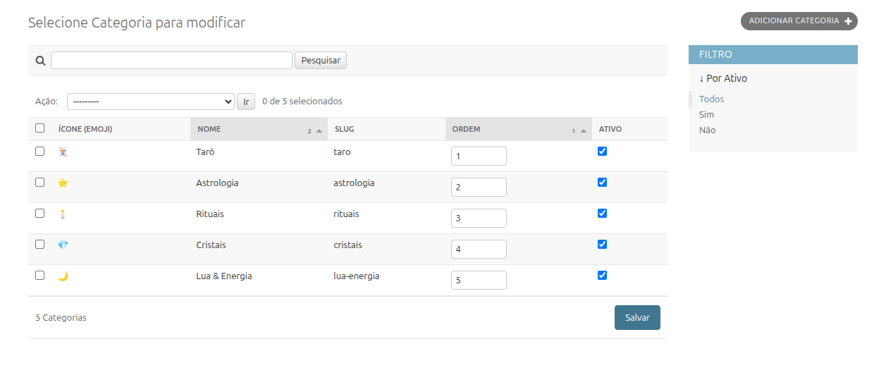

### 5.2. Preencher os campos da categoria

- **Nome** *(obrigatório):* o nome do tema. *Exemplo:* `Numerologia`. Cada nome deve ser único (não pode repetir).
- **Slug:** o endereço na internet — preenche sozinho a partir do nome. Pode deixar como está.
- **Descrição** *(opcional):* um textinho explicando o tema. Pode deixar em branco.
- **Ícone (emoji)** *(opcional):* um emoji que representa o tema (o sistema já sugere 🔮). Você pode trocar por ❤️, 🌙, ⭐, o que combinar.
- **Ordem** *(opcional):* número que define a posição da categoria nas listagens. Menor número aparece primeiro.
- **Ativo:** caixinha de marcar, que já vem marcada. Marcada (✓) = a categoria aparece no site. Desmarcada = fica escondida.

Ao terminar, clique em **"SALVAR"**.

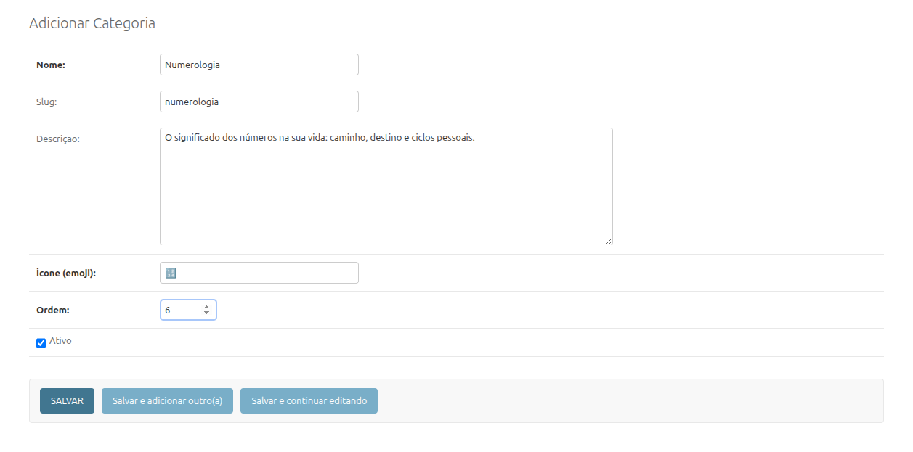

### 5.3. Editar ou apagar

- Para **editar**, clique no nome da categoria na lista, mude o que quiser e salve.
- As colunas **Ordem** e **Ativo** também podem ser mudadas direto na lista (lembre de clicar em "Salvar" no final).
- Para **apagar**, abra a categoria e clique no botão vermelho **"Apagar"**, confirmando na tela seguinte. *(Cuidado: se apagar uma categoria, as postagens que estavam nela ficam sem categoria — mas as postagens **não são apagadas**, apenas ficam "sem tema".)*

---

## 6. Tags (etiquetas)

As **Tags** são etiquetas menores, palavras-chave que descrevem detalhes da postagem (ex.: "Lua Cheia", "Amor", "Prosperidade"). Uma postagem pode ter várias tags. Elas são mais específicas que as categorias.

### 6.1. Ver e criar tags

1. Na tela principal, clique em **"Tags"**.
2. Você vê a lista com **Nome** e **Slug**.
3. Para criar, clique em **"ADICIONAR TAG ✚"** (canto superior direito).

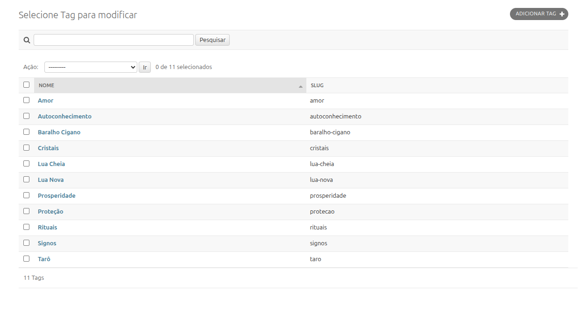

### 6.2. Preencher os campos da tag

- **Nome** *(obrigatório):* a palavra-chave. *Exemplo:* `Ano Novo`. Deve ser única (não repetir).
- **Slug:** preenche sozinho a partir do nome. Pode deixar como está.

Clique em **"SALVAR"**.

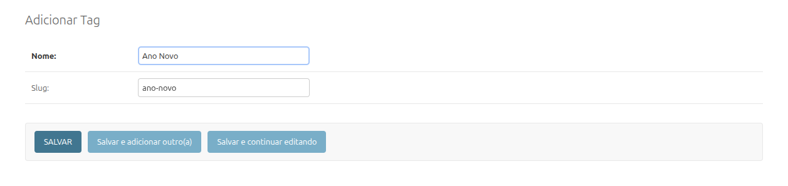

> 💡 Você também pode criar uma tag na hora de escrever uma postagem, clicando no sinal **✚** verde ao lado do campo "Tags" (abre uma janelinha) — mas é mais organizado criá-las aqui antes. Depois, no formulário do post (Seção 2.3), é só escolhê-las na lista.

### 6.3. Editar ou apagar

- Para **editar**, clique no nome da tag, mude e salve.
- Para **apagar**, abra a tag e clique no botão vermelho **"Apagar"**, confirmando na tela seguinte. *(Apagar uma tag só remove a etiqueta; as postagens continuam existindo normalmente.)*

---

## 7. Consultas recebidas (pagamentos)

Aqui é onde você acompanha **quem agendou consultas e quem já pagou**. Fica no item **"Consultas"**, no bloco CONSULTAS da tela principal.

> 📌 **Importante entender:** essa lista é criada **automaticamente** pelo site. Toda vez que uma pessoa preenche o formulário de consulta e vai pagar, o sistema cria um registro aqui sozinho. **Você não precisa (e não consegue) criar consultas na mão** — repare que nesta tela não existe o botão "Adicionar", diferente das outras. Isso é de propósito. Sua função aqui é **acompanhar e conferir**.

### 7.1. Ver a lista de consultas

1. Na tela principal, clique em **"Consultas"**.
2. Aparece a lista, da mais recente para a mais antiga. Em colunas você vê:
   - **Nome** — o nome do cliente;
   - **Tipo de consulta** — qual serviço a pessoa escolheu (com o preço atual do serviço ao lado);
   - **Valor (R$)** — quanto foi cobrado **naquela** consulta;
   - **Status** — a situação do pagamento (explicado abaixo);
   - **Pagamento com valor divergente** — um aviso de atenção (explicado abaixo);
   - **WhatsApp** — o telefone do cliente;
   - **Referência** — um código único e comprido daquela consulta;
   - **Criado em** — data e hora em que a pessoa agendou.

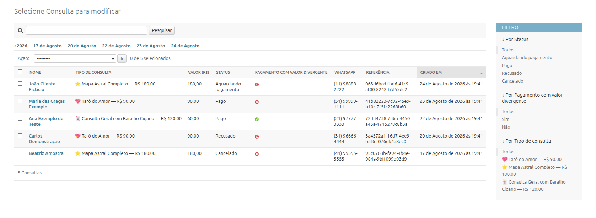

### 7.2. Entender o Status (situação do pagamento)

O **Status** diz em que pé está cada consulta. São quatro situações:

- **Aguardando pagamento** — a pessoa agendou, mas ainda **não pagou**. Pode ser que pague em instantes ou desista. Só aguardar.
- **Pago** — 🎉 **o pagamento foi confirmado!** Está tudo certo, a pessoa pagou. É a partir daqui que o cliente é liberado para falar com você pelo WhatsApp.
- **Recusado** — a pessoa tentou pagar, mas o pagamento **não foi aprovado** (cartão recusado, etc.). A consulta não vale.
- **Cancelado** — a consulta foi **cancelada** (por exemplo, um estorno/devolução do dinheiro).

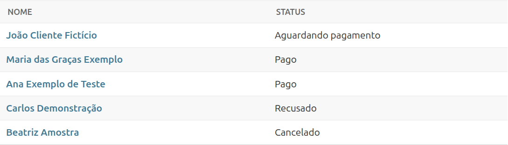

### 7.3. O aviso "Pagamento com valor divergente"

A coluna **"Pagamento com valor divergente"** é um **alerta de segurança**: ela avisa quando **o valor que a pessoa pagou foi diferente do valor que deveria ter pagado**.

> ⚠️ **Preste muita atenção neste detalhe, porque as cores enganam:**
> - **✔ verde = SIM, houve divergência.** É o caso que pede a sua atenção!
> - **✘ vermelho = Não, está tudo certo.** É o que aparece na maioria das consultas.
>
> Ou seja: aqui o **verde é o sinal de alerta**, porque ele está respondendo "sim" à pergunta "houve divergência?".

No exemplo abaixo, a consulta destacada custava R$ 120,00 mas foi paga com R$ 60,00 — por isso ela está marcada com o ✔ verde, mesmo com o status "Pago".

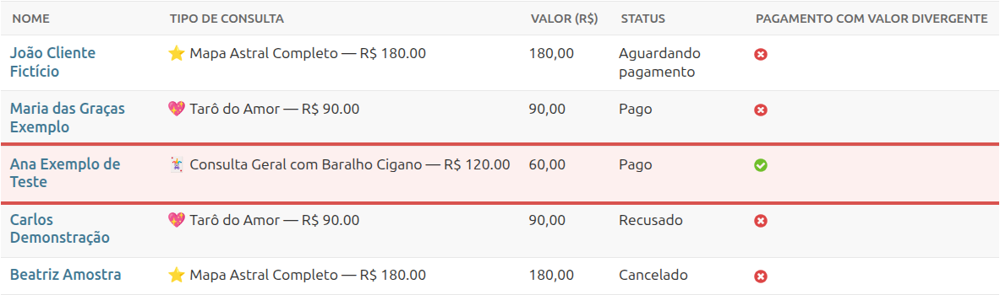

Se você vir esse ✔ verde, **confira com calma antes de atender**: compare o "Valor (R$)" da consulta com o preço do serviço e, se precisar, converse com o cliente para entender o que houve.

### 7.4. Filtrar e buscar consultas

- **Filtros** (painel FILTRO, à direita): você pode filtrar **Por Status** (ver só as "Pago", por exemplo), **Por Pagamento com valor divergente** (Sim / Não) e **Por Tipo de consulta**.
- **Busca** (topo): digite o **nome**, o **e-mail**, o **WhatsApp** ou a **referência** do cliente e clique em "Pesquisar" para achar rapidinho uma consulta específica.
- **Por data:** logo acima da lista há uma navegação por datas para achar as consultas de um dia ou mês.

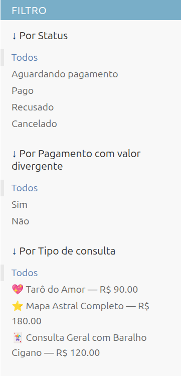

### 7.5. Ver os detalhes de uma consulta

Clique no **nome do cliente** para abrir os detalhes. Você verá todos os dados: **Status**, **Referência**, **Tipo de consulta**, **Nome**, **E-mail**, **WhatsApp**, **Valor (R$)**, se houve **pagamento com valor divergente**, os códigos internos do Mercado Pago (**ID da preferência** e **ID do pagamento**, que são os números do sistema de pagamento) e as datas de **Criado em** e **Atualizado em**.

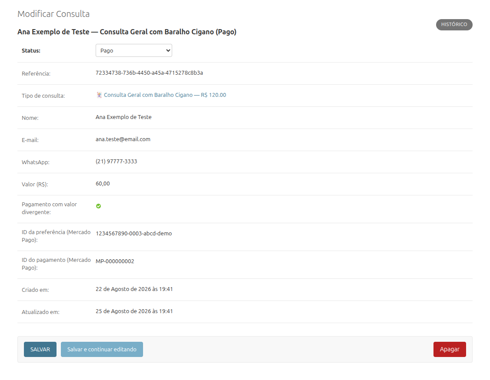

> 🔒 **Quase tudo aqui é só para leitura.** Os dados do cliente, o valor, a referência e os códigos do pagamento **não podem ser alterados** — são preenchidos automaticamente pelo sistema de pagamento (Mercado Pago). Se você tentar clicar neles, nada acontece: é assim mesmo que tem que ser.
>
> ⚠️ **A única exceção é o campo "Status", que aparece como uma caixinha e pode ser mudado à mão. Não mexa nele.** O status é atualizado sozinho pelo Mercado Pago conforme o pagamento acontece. Se você mudar manualmente (por exemplo, marcar como "Pago" uma consulta que não foi paga), o site vai liberar o contato para uma pessoa que não pagou, e o registro deixa de corresponder à verdade. Em caso de dúvida sobre um pagamento, fale com quem cuida da parte técnica do site em vez de mexer aqui.

---

## 8. Dicas de segurança e boas práticas

Cuidar bem do painel é cuidar bem do seu site e dos dados dos seus clientes. Siga estas dicas simples:

### 8.1. Sobre a senha

- Use uma **senha forte**: pelo menos 8 caracteres, com letras e números misturados. Evite datas de nascimento, nomes de filhos/netos e sequências óbvias (como "123456" ou "senha").
- **Nunca compartilhe sua senha** com estranhos. Se realmente precisar que alguém ajude no site, prefira acompanhar de perto.
- **Não deixe a senha anotada em lugares visíveis** (como um papel colado no monitor). Guarde num caderninho em local seguro.

### 8.2. Ao usar o painel

- **Sempre saia** clicando em "ENCERRAR SESSÃO" ao terminar, principalmente em computador compartilhado ou público (Seção 1.2).
- Evite acessar o painel em **computadores de terceiros** ou em **redes de Wi-Fi públicas** (lanchonetes, aeroportos). Se precisar, saia bem e não salve a senha no navegador desse aparelho.
- Se a tela pedir a senha e você errar, **digite com calma** — lembre que 5 erros seguidos bloqueiam o acesso por 1 hora.
- Não mexa nos blocos **"AUTENTICAÇÃO E AUTORIZAÇÃO"** (Grupos e Usuários) e **"AXES"** da tela principal. Eles cuidam de quem pode entrar no painel e do registro de tentativas de acesso — é assunto de quem cuida da parte técnica.

### 8.3. Ao apagar coisas

- **Apagar é para sempre.** Postagens, categorias e tags apagadas não voltam.
- Antes de apagar uma postagem, pergunte-se: *"não seria melhor só deixar como Rascunho?"* — assim ela some do site mas continua guardada, caso você mude de ideia.
- **Nunca apague uma consulta** achando que "não serve mais" — ela é o registro de um pagamento real e faz parte do seu histórico financeiro.
- Leia sempre a tela **"Tem certeza?"** antes de confirmar: ela lista tudo o que vai ser removido junto.

### 8.4. Sobre as consultas e pagamentos

- As consultas são **registros oficiais de pagamentos**. Trate-as com o mesmo cuidado que trataria um comprovante.
- Sempre confira o **Status "Pago"** antes de atender alguém, e fique atenta ao ✔ verde na coluna **"Pagamento com valor divergente"** (Seção 7.3).
- **Não altere o Status de uma consulta à mão.** Ele é atualizado automaticamente pelo sistema de pagamento; mexer nele desalinha o registro da realidade.
- Os dados dos seus clientes (nome, e-mail, WhatsApp) são informações pessoais. Não repasse a terceiros nem tire prints dessa tela para compartilhar.

### 8.5. Em caso de dúvida ou problema

- Se algo parecer estranho (uma tela diferente, um erro, algo que não abre), **não se preocupe e não force**. Anote o que aconteceu (pode até tirar uma foto da tela) e peça ajuda a quem cuida da parte técnica do site.
- Errar preenchendo um campo **não quebra nada**: se faltar algo obrigatório, o painel avisa em vermelho e é só corrigir e salvar de novo. O painel foi feito para ser seguro para você usar.

---

> 💛 **Pronto!** Com este manual você já consegue cuidar do seu site com autonomia. Vá com calma, faça um passo de cada vez, e logo tudo vai parecer fácil e natural. Qualquer dúvida, é só voltar aqui e reler a seção que precisar. Boa jornada! ✨
